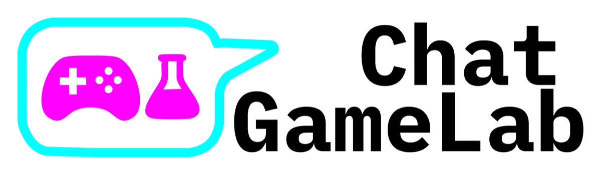

  

<h3 align="center">Games that show how AI works</h3>

  <a href="https://flocko-motion.github.io/chatgamelab/"><b>Homepage</b></a> ·
  <a href="https://flocko-motion.github.io/chatgamelab/roadmap/"><b>What's coming</b></a> ·
  <a href="#documentation"><b>Documentation</b></a>

ChatGameLab is a place where young people play games run by AI, invent their
own, and find out along the way what AI can do and how it does it.

- **Play.** Step into a story, decide what your character does, and see how the
  world answers. With pictures and voices, if you like.
- **Invent.** Make up your own game: a world, a story, a look of its own. Then
  share it with friends.
- **Understand.** Every game lets you look behind the scenes: what the AI is
  asked, what it answers, and why the story turns out the way it does.

Schools, youth centres, libraries and other organisations use ChatGameLab in
their workshops, to talk about AI by playing with it. Players join a workshop
with a link and need no account, and every game follows rules for the players'
age group.

## Take part

ChatGameLab is open source. Organisations use it with their own groups, anyone
can follow how it grows, and everyone is welcome to take part: with ideas and
feedback in the [issues](https://github.com/flocko-motion/chatgamelab/issues),
or with code, design and texts through a pull request.

The [roadmap](https://flocko-motion.github.io/chatgamelab/roadmap/) shows
what's being worked on and what comes next; [epics
only](https://flocko-motion.github.io/chatgamelab/roadmap/#epics) gives the
overview.

## Documentation

**Getting started**

- [Developing ChatGameLab](docs/development.md): requirements, setup, running it on your machine
- [Contributing](CONTRIBUTING.md): the path from your first branch to a merged pull request

**What ChatGameLab is and how it's built**

- [The spec](docs/chatgamelab.typ): what ChatGameLab does, feature by feature
- [Architecture](ARCHITECTURE.md): how the code is organised, and [the engine's](go/engine/ARCHITECTURE.md)
- [How the AI game engine works](TECHNOLOGY.md): from creating a session to each turn

**Guides**

- [Styling an embedded game](docs/embed-styling.md): for websites that embed a game
- [Running an instance](deploy/README.md): setting up a server for ChatGameLab
- [Releasing](docs/workflows/releasing.md), [reviewing](docs/workflows/review.md), [opening the seal](docs/workflows/opening-the-seal.md): the maintainers' workflows
- [Rules](docs/rules/): conventions beyond the spec, each for the files it names
- [The roadmap](roadmap/README.md) and [the homepage](homepage/): how they are built
