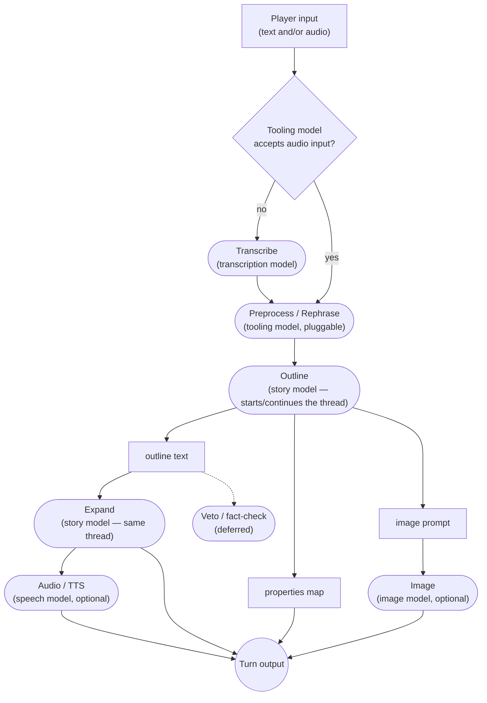

# Engine architecture

ChatGameLab's game engine: a Go module that runs one AI-driven game session,
embedded in the platform or served on its own. The platform owns accounts,
workshops, sharing and authoring; the engine owns everything from a resolved
session spec onwards.

This document sits between the spec and the code. The spec
(`docs/chatgamelab.typ`) says what the platform does; this outlines how the
engine is built to do it; the code holds the details.

## Blocks

The engine ships a library of **building blocks**, each wrapping one mechanism
and configured by prompt into whatever role a genre needs:

| Block | Mechanism | Roles |
| --- | --- | --- |
| **Tool call** | one single-shot text-in/text-out call | rephrase, condense, translate, observer |
| **Threaded call** | a call on a continuing conversation | Outline and Expand, sharing one thread |
| **Structured extraction** | a call returning a typed properties map | status tracking, theme generation |
| **Image generation** | prompt in, image out | scene illustration, portrait |
| **Speech synthesis** | text in, audio out | narration |
| **Transcription** | audio in, text out | voice input on a turn-based genre |
| **Live session** | a long-lived, full-duplex speech-to-speech connection | NPC-Live's conversation |

A new short transformation is a prompt on an existing block, which keeps the
library small. Player inputs are source nodes and outputs are sink blocks
without a model call, one node per stream, so a genre's event schema reads
straight off its graph.

## Wiring

A genre is **Go code that wires blocks together**: a small, fixed, compiled-in
set, written by hand.

- **Ports are typed by the data they carry**, and the compiler checks every
  edge.
- **Fan-out** gives each consumer its own stream; **a cycle is a back edge**
  like any other. NPC-Live's observer loop is one.
- **A per-genre test checks completeness**: every required input and output is
  wired, and every block is reachable from an input.
- Two genres justify neither a DSL nor a generic scheduler, so the graph stays
  Go and keeps its type safety.

### Init, gate, loop

A genre's graph is **P-shaped**: an init stem that runs once, a **gate**, and
the loop. The gate waits for the blocks wired into it to report
working-then-ready, releases the player's inputs, and sends the opening message:
the scenario followed by the cue. What gates is a wiring decision; NPC-Live
gates on its portrait.

Every block reports its state changes, and every report reaches the client,
which draws the wiring once and then tracks phases.

## Genres

### Adventure

**Rephrase → outline → expand**, because a single-shot "what happens next" call
is too willing to do what the player asked. Rephrase turns the input into third
person with an uncertain outcome; Outline models a plausible world reacting to
it; Expand turns the outline into prose.



Transcribe runs only when the model resolved into the Preprocess slot takes text
alone. Image and Audio are always wired; the session's `images` and `audio-out`
toggles switch them on and off.

### NPC-Live

A portrait is generated and gates the conversation; the loop is currently a
single live session, keeping the player's voice and the reply directly
connected.

Control comes from the side: an **observer** reads the character's transcript,
judges it against the guardrail, for sycophancy and for character, and injects a
correction back into the live session. It needs its own thread, because a
character softens across several exchanges.

The scenario and the guardrail reach the model through separate channels of the
live session, so designer text and the platform's constraint stay apart.

## AI platforms

The engine publishes a **catalogue** of the AI platforms it runs: what a person
needs to understand when choosing a platform and a tier. Its settings are
written into the engine.

- **A platform** has an id, a name, whether it accepts a user's own API key, and
  four **toggles**, each saying whether a feature exists on it: `images`,
  `audio-out` (narration), `audio-in` (voice input) and `audio-live`
  (full-duplex speech).
- **A genre declares the toggles it needs**, so the genres a platform can run
  follow from its toggles. NPC-Live needs `audio-live` and `images`; a launch
  on a platform that lacks one is refused.
- **A tier decides quality, never whether a feature exists.** The tiers are
  `low`, `medium` and `high`, labelled Economy, Balanced and High; `max` is
  read as `high`.
- **Each tier lists a model per model type**, with the parameters it is called
  with, such as a picture's size and quality or a voice's name and format.
  `tooling` and `story` are always listed; each toggle that is on adds one:

| Toggle | Model type | Used by |
| --- | --- | --- |
| — | **tooling** | rephrase, translate, observer |
| — | **story** | Outline and Expand, on one continuing conversation |
| `images` | **image** | image generation |
| `audio-out` | **speech** | speech synthesis |
| `audio-in` | **transcription** | transcription |
| `audio-live` | **live** | the live-session block |

Tiers have capabilities and model choices: a model and its parameters are set
in the tier table and nowhere else.

- **An offer** is one way a session may run: a platform, a key and the
  **caveats** on using it, named by a unique ID such as the shared key's.
  Everything names an offer by its ID, never by position. Caveats select what
  is allowed and never change a model or a parameter.
- **Caveats** are an allowance, the toggles allowed at each tier the offer may
  be used at; a default tier and toggles inside it; and whether the player may
  customize.
- **Settling** picks the session's offer, tier and toggles from the offers and
  the player's preference. With customization off the default applies; with it
  on the player chooses within the allowance, less than the default included.
  Whatever is settled must meet the genre's needs; a session never changes
  platform.
- **The preference is the player's wish**: a platform, an offer's ID, a tier
  and toggles. It is persisted with the spec and fitted to the current
  offers on every settle, since a share can change during a game: the same
  offer or another on the same platform, the nearest allowed tier, toggles no
  longer allowed switched off. A choice sent from the options dialog that lies
  outside the caveats is refused instead.
- **Toggles are switches in a fixed graph.** The settled toggles are their
  starting positions; during play a toggle may go off at any time and on when
  the offer allows it at the session's tier. A block whose toggle is off does
  no work and bills nothing, and what it made before stays.
- **`engine.Validate`** reports a spec's errors and warnings, each with a field
  path. Launch and resume refuse any error; a platform may call it ahead of a
  launch.

The catalogue is exposed as `engine.Platforms()`, as the transport's
`GET platforms`, and printed by `cmd/models`.

Conversation continuity — the thread, the live conversation — is per-block
state, keyed by the block's name.

## The session spec

A session launches from a spec and the offers it may run on; the engine
resolves nothing against platform data.

- **Scenario and guardrail** — the designer's text and the platform's
  youth-protection constraint, already resolved.
- **Genre prompts** — the mechanics, belonging to the genre as a named map. A
  spec may replace any of them.
- **Genre, title, image style.**
- **The player's preference** — the wish described above, naming an offer by
  its ID, once the player has chosen.
- **The voice.**

The spec is what is stored. **Offers are live inputs** beside it, like
persistence: `Launch`, `Resume` and `Validate` take them as an argument, and
`Adapt` replaces them. Each is a platform, a key provider and caveats; the key
provider is an injected function, so nothing stored holds a secret and a
rotated key takes effect on the next call. An offer with errors, or without an
ID of its own, is left out with a warning; no usable offer refuses the launch.
Only the standalone launcher and the engine's tests supply the mock's offer.
A launcher's game file keeps the two apart: `{ "spec": …, "offers": […] }`.

The platform assembles a spec from its cascade; a standalone launcher or a third
party assembles one by hand. The engine treats both the same.

## Sessions and persistence

**Auth authorises launching a session; the session id plays it.** The id is a
bearer handle scoped to one session, so an embedded player can hold it while the
key stays on the server.

- **A session is its spec, its state and its event log.** The spec is fixed at
  launch; the state holds what blocks export, such as conversation continuity.
- **History is the ordered log of everything that reached an output sink**,
  replayed through the same client path as live events.
- **Storage is injected** and written at checkpoints during a turn.
- **A schema version mismatch invalidates the session.** Sessions are
  disposable; Games and Users keep real migrations.
- **A session may begin by choosing.** With more than one offer, or one the
  player may customize, the graph is built and waits: the player's options
  dialog reads the offers, sends a choice, and the game starts. Nothing runs
  or bills before. A stored preference skips the dialog.
- **Every settlement is announced** on the `settled` stream with the
  preference, so the platform stores it with the spec; an in-game toggle
  change is announced the same way.
- **A running session adapts** when the platform passes it new offers: the
  preference is fitted again, the blocks' adapters are replaced in place, and
  the player is told what changed. An offer on another platform ends the
  session.

## Code boundary and deployment

The engine is a sibling module of the server, and the compiler keeps its
internals out of reach of any other module.

- **Public surface**: a launched or resumed session, driven by plain Go calls
  and read as a stream of events.
- **One HTTP transport, used two ways.** The core serves no HTTP.
  - **Embedded**: the server launches sessions from its own routes and mounts
    the engine's handlers in its router, behind its own middleware.
  - **Standalone**: a small launcher serves the same handlers from a
    hand-assembled spec.

  The transport deals in sessions and the catalogue; authentication, roles and
  share links belong to whoever mounts it.
- **The player is embedded** in the module and addresses the engine with
  relative URLs under any mount point.

chatgamelab.eu runs embedded, so every request passes the platform's checks
before reaching the engine, and a revoked key or withdrawn share takes effect on
the next request despite the frozen spec.

A live conversation runs between the browser and the provider, so a platform
restart drops only the engine's watch over it. A live session is pinned to one
process, which matters once a standalone engine runs more than one replica.

## Usage and cost

Blocks report **cumulative totals** on a port of their own, in three units: text
per token (cached input apart), live conversation per second, pictures per
picture. The engine prices them from a hand-maintained, dated table and reports
per block and per model, with a flag for whether every model was priced.

## Protocol

**The session-scoped event stream is the protocol**, carried according to the
genre's interaction model: a voice genre uses one duplex connection for audio
and events; a turn-based genre reads events as a stream and sends actions as
requests. A genre's wired output sinks define its event types. Utterance
boundaries travel in-band.

**Live audio is browser-direct, watched through a sideband:**

```text
browser ──── WebRTC media + data channel ────> provider
   │                                              │
   └── connection offer ──> engine ── sideband ───┘
```

The engine brokers the connection and attaches to the session separately,
receiving transcripts, usage and close reasons and sending control events. The
key and the provider's session id stay on the server.

**An idle conversation is closed**, since a live session bills while open, and
resumed on request: from a fork of the provider's stored session, or from a
fresh session seeded with the transcript the engine kept in memory.

A reloading page rebuilds from the session's topology, state and history.

## Frontend

The player is **plain HTML, CSS and TypeScript, with no framework**: a game turn
is a timeline of concurrently timed streams, which wants imperative sequencing.
A dependency is welcome when it takes data and paints, and kept out when it
wants to own when things render.

- **The headless core is the player.** It owns the whole session state, so a
  full game plays without a browser; the UI paints that state and pipes input
  back.
- **The build output is committed** and embedded, so building the engine needs
  no JavaScript toolchain.
- **One player** serves the platform and every embedder, through the same
  iframe.

## Testing

A mock platform implements every adapter with canned, paced output, so genre and
pipeline tests run in-process with no key or network, and it can script a
drifting character for the observer to catch. An integration test plays a
session end to end with the headless player.

## Build state

### Built

- The block graph: typed ports, the gate, state reporting, per-genre validity
  tests.
- NPC-Live end to end on real adapters: portrait, live session with sideband,
  observer, idle close and resume, cost reporting.
- The HTTP transport, the standalone launcher, and the headless player with its
  instrumentation view.
- The mock platform.

### Missing

- **Adventure's real blocks** — tool call, threaded call, extraction, speech
  synthesis and transcription. Adventure is wired from dummies.
- **The observer's thread** — it judges each line on its own.
- **Persistence** — storage is in-memory only; the platform's implementation and
  schema-version invalidation are still to come.
- **Platform integration** — the server neither launches nor mounts the engine
  yet. Once it does, v1 is deleted, frontend and backend both.
- **Re-attaching to a live conversation** after a platform restart.
- **Locking down the browser's data channel** to the commands the player needs.
- **A veto block**, once the spec settles whether a turn can be rejected.
- **Delegation** — a backend model beside the live conversation, where
  outline-and-expand could run behind a voice. Fixed at session creation, and
  billed on top of the voice minutes.
- **Observer cadence** — streamed deltas or completed replies.
