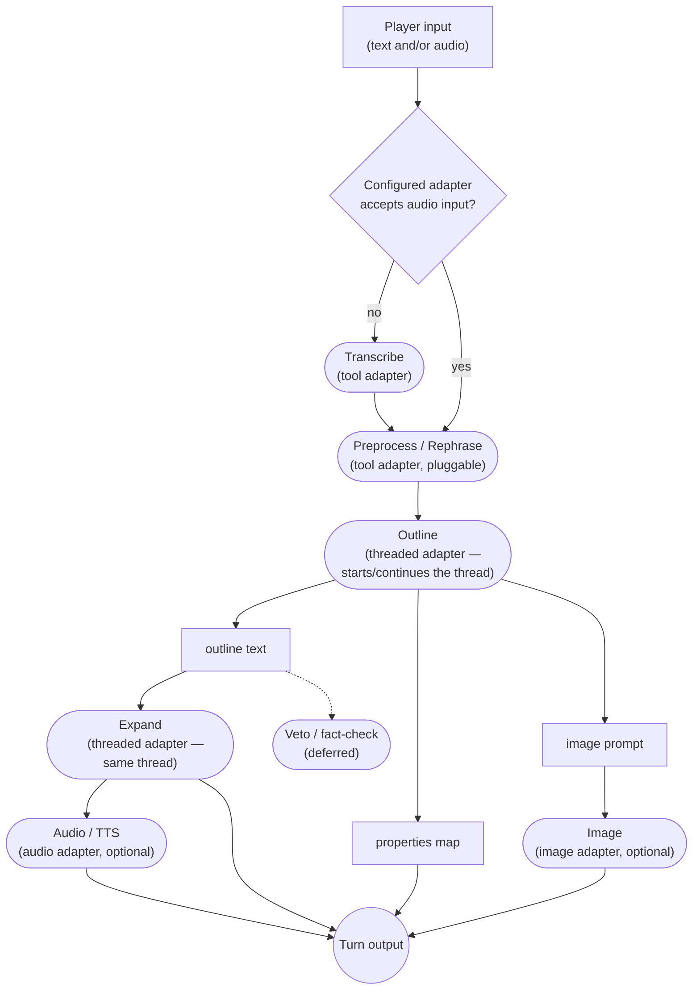

# ENGINE.md

ChatGameLab's game engine: a Go module that runs one AI-driven game session,
embedded in the platform or served on its own. The platform owns accounts,
workshops, sharing and authoring; the engine owns everything from a resolved
`SessionSpec` onwards.

## Blocks

The engine ships a library of **building blocks**, each wrapping one mechanism
and configured by prompt into whatever role a genre needs:

| Block | Mechanism | Roles |
| --- | --- | --- |
| **Tool call** | one single-shot text-in/text-out call | rephrase, condense, translate, observer |
| **Threaded call** | a call on a continuing conversation | Outline and Expand, sharing one thread |
| **Structured extraction** | a call returning a typed properties map | status tracking, theme generation |
| **Image generation** | prompt in, image out | scene illustration, portrait |
| **Speech synthesis** | text in, audio out | narration |
| **Transcription** | audio in, text out | voice input on a turn-based genre |
| **Live session** | a long-lived, full-duplex speech-to-speech connection | NPC-Live's conversation |

A new short transformation is a prompt on an existing block, which keeps the
library small. Inputs are source nodes and output sinks (`output-text`,
`output-audio`, `output-image`, `output-status`) are blocks without a model
call, one node per stream, so a genre's event schema reads straight off its
graph.

## Wiring

A genre is **Go code that wires blocks together**: a small, fixed, compiled-in
set, written by hand.

- **Ports are Go interfaces, one pair per data type**, and wiring is
  `Graph.Connect<Type>Out(src, dst)`. The compiler checks every edge.
- **Fan-out is connecting a source twice**, each consumer with its own stream;
  **a cycle is a back edge** like any other. NPC-Live's observer loop is one.
- **A per-genre test checks completeness**: every required input and output is
  wired, and every block is reachable from an input.
- Two genres justify neither a DSL nor a generic scheduler, so the graph stays
  Go and keeps its type safety.

### Init, gate, loop

A genre's graph is **P-shaped**: an init stem that runs once, a **gate**, and
the loop. The gate waits for the blocks wired into it to report
working-then-ready, releases the player's inputs, and sends the opening message:
the scenario followed by the cue. What gates is a wiring decision; NPC-Live
gates on its portrait, so the player sees who they are talking to before
speaking.

Every block reports its state changes, and every report reaches the client,
which fetches the wiring once from `/topology` and then tracks phases.

## Genres

### Adventure

**Rephrase → outline → expand**, because a single-shot "what happens next" call
is too willing to do what the player asked. Rephrase turns the input into third
person with an uncertain outcome; Outline models a plausible world reacting to
it; Expand turns the outline into prose.



Transcribe runs only when the model resolved into the Preprocess slot takes text
alone. Image and Audio are toggled in Adventure's configuration.

### NPC-Live

A portrait is generated and gates the conversation; the loop is currently a
single live session, keeping the player's voice and the reply directly
connected. `make describe SPEC=examples/stopped-clock.json` prints the wiring.

Control comes from the side: an **observer** reads the character's transcript,
judges each line against the guardrail, for sycophancy and for character, and
injects a correction back into the live session. It keeps its own thread,
because a character softens across several exchanges.

The **scenario** is the model's `instructions` and the **guardrail** a separate
`developer` message, so designer text and the platform's constraint occupy
different fields. The player's own speech is transcribed and stays in the
process.

A live model holds character through a long natural conversation. Whether the
observer can pull it back when it drifts is open research.

## AI adapters

Blocks use five **adapter roles**, each resolving to its own model under the
session's one platform and key:

| Role | Used by | Continuity |
| --- | --- | --- |
| **Tool** | rephrase, transcribe, translate, observer | single-shot |
| **Threaded** | Outline and Expand | one continuing conversation |
| **Image** | image generation | single-shot |
| **Audio** | TTS, transcription | single-shot |
| **Live** | the live-session block | one long-lived duplex session |

A session names one **tier** — economy, balanced, premium or max — and the
platform's preset table turns it into a model per role, plus the picture's size
and quality. `ModelLive: "gpt-live-1"` pins a role to a model; `ModelThreaded:
"$max"` lifts one role to another tier. Economy is a real rung: a workshop is a
room of young people on a school's budget.

Continuation tokens — the threaded conversation's response id, the live
session's conversation id — are per-block state, keyed by the block's name.

## The SessionSpec

A session launches from one self-contained `SessionSpec`; the engine resolves
nothing against platform data.

- **Scenario and guardrail** — the game designer's text and the platform's
  youth-protection constraint, already resolved from its cascade.
- **Genre prompts** — the mechanics, in the genre's Go file as a named map. A
  spec may replace any through `PromptOverride`, and `/prompts` shows what a
  session runs on.
- **Genre, title, image style** — the style is the designer's, with a default
  so a session's pictures match each other.
- **AI configuration** — platform, tier, per-role overrides and the voice.
- **A key provider** — an injected function, so the persisted spec holds no
  secret and a rotated key takes effect on the next call.

The platform assembles a spec from its cascade; a standalone launcher or a third
party assembles one by hand. The engine treats both the same.

## Sessions and persistence

**Auth authorises launching a session; the session id plays it.** The id is a
bearer handle scoped to one session, so an iframe can hold it while the API key
stays on the server.

| Table | Columns |
| --- | --- |
| `sessions` | `id`, `schema_version`, `spec` (JSON blob), `state` (JSON blob) |
| `events` | `session_id`, `seq`, `stream`, `value` |

- **History is the ordered log of everything that reached an output sink.**
  `/history` replays it, and the client applies replayed events through the same
  code as live ones.
- **`Persist` is injected** and called at checkpoints during a turn: Postgres in
  the platform, memory in `engineserver`, SQLite for a future standalone build.
- **A schema version mismatch invalidates the session.** Sessions are
  disposable; Games and Users keep real migrations.
- **A live conversation is ephemeral**: the portrait and the observer's flags
  are what a session keeps.
- **Erasing a user** spans the platform's mapping table and the engine's
  content, and is one written procedure.

## Code boundary and deployment

The engine is a sibling Go module, joined to `server` by `go.work`. Its
internals live under `internal/`, which the compiler keeps out of reach of any
other module.

- **Public API**: `Launch(ctx, spec)` and `Resume(ctx, spec, state)` return a
  `*Session`, which the caller drives with plain Go calls (`Say`, `Speak`,
  `Connect`, `Pause`), reads through `Events()` and snapshots through `State()`.
- **One HTTP transport, `engine/api`, used two ways.** The core `engine` package
  serves no HTTP.
  - **Embedded**: the ChatGameLab server launches sessions from its own routes,
    registers them with `api.API`, and mounts the handlers in its router behind
    its own middleware, one by one or as the subtree from `Handler()`.
  - **Standalone**: `cmd/engineserver` loads a hand-assembled spec from a file
    and serves the same handlers on a plain mux.

  The transport deals only in session ids and engine calls; authentication,
  roles and share links belong to whoever mounts it.
- **The player is embedded** with `//go:embed` and served from the engine's
  subtree, so it addresses the API with relative URLs under any mount point.

chatgamelab.eu runs embedded, so every request passes the portal's auth, role
and share checks before reaching the engine, and a revoked key or withdrawn
share takes effect on the next request despite the frozen spec.

A live conversation survives a portal deploy: it runs between the browser and
OpenAI, and a restart drops only the engine's sideband, leaving the conversation
unmetered and unobserved. Re-attaching after a restart is deferred. A live
session is pinned to one process, which matters once a standalone engine runs
more than one replica.

## Usage and cost

Blocks report **cumulative totals** on a port of their own, in three units: text
per token (cached input apart), live conversation per second, pictures per
picture. The engine prices them from a hand-maintained, dated table
(`internal/adapters/openai/prices.go`) and reports per block and per model, with
a flag for whether every model was priced. The player shows it as a live cost
ticker.

## Protocol

**The session-scoped event stream is the protocol**, carried according to the
genre's interaction model: a voice genre opens a WebSocket (`/live`) carrying
audio up and events down; a turn-based genre reads the same events over SSE
(`/stream`) and posts actions to `/input`. A genre's wired output sinks define
its event types. Utterance boundaries travel in-band, as an empty text delta.

**A voice genre takes voice.** GPT-Live accepts user text only as context, so
NPC-Live has no typed input, and playing it takes a microphone.

**Live audio is browser-direct, watched through a sideband:**

```text
browser ──── WebRTC media + data channel ────> OpenAI
   │                                              │
   └── SDP exchange ──> engine ── sideband WS ────┘
```

The engine brokers the SDP exchange and attaches to the session separately,
receiving transcripts, usage and close reasons and sending control events. The
key and OpenAI's session id stay on the server.

**An idle conversation is let go** after a minute of silence on both sides,
since GPT-Live bills for the time a session is open. The player's one control
resumes it; the character carries on from a fork of the stored session, or from
a fresh session seeded with the transcript the engine kept.

A reloading page rebuilds from REST — `/topology`, `/state`, `/history` — and
the instrumentation reads `/nodes/{name}`, `/edge`, `/prompts` and
`/flowchart`. `api.Handler()` lists them all.

## Frontend

The player is **plain HTML, CSS and TypeScript, with no framework**: a game turn
is a timeline of concurrently timed streams, which wants imperative sequencing.
A dependency is welcome when it takes data and paints — tsParticles, Cytoscape —
and kept out when it wants to own when things render.

- **The headless core is the player.** It lives in `web/src` and owns the whole
  session state, so a full game plays from node; the UI in `web/src/ui` paints
  that state and pipes input back.
- **`web/dist` is committed** and embedded, so building the engine needs no
  JavaScript toolchain. `make web` rebuilds it, `make dev` rebuilds and serves.
- **The layout is split**: the conversation on the left, the wiring as a live
  Cytoscape graph with a details panel on the right.
- **The player is iframe-embeddable**, sized by the host's CSS. The portal uses
  the same iframe, so there is one player to maintain.

## Testing

The mock platform (`internal/adapters/mock`) implements every adapter with
canned, paced output, so genre and pipeline tests run in-process with no key or
network. It can script a drifting character for the observer to catch. An
integration test mounts the API with `httptest` and plays a session end to end
with the headless player under node.

## Rollout

1. **Scaffold and spike** *(done)* — both genres wired, real OpenAI adapters,
   a mock platform, and a playable live character with a cost ticker.
2. **Adventure** — rebuilt by wiring the building blocks, proving the library
   expresses what v1 does.
3. **NPC-Live** — expected to expose seams the library, shaped by Adventure,
   cut wrong. Its open research question is the observer: whether it pulls a
   drifting character back, and how often it fires on one that hasn't drifted.
4. Once v2 works and is wired into the portal, **v1 is deleted**, frontend and
   backend both.

## Deliberately deferred

- **Veto/fact-check block** — a stage with authority to reject a turn's output.
  Under NPC-Live the character is already speaking as it generates, so youth
  protection needs a decision here before the voice genre ships.
- **What a live session persists** — ephemeral for now, possibly the portrait.
- **Delegation** — a GPT-Live backend model working beside the conversation:
  where outline-and-expand could run behind a voice, where the veto block could
  live, and where typed input gets a route. The mode is fixed at session
  creation and bills tokens on top of the voice minutes.
- **Per-session spend or duration bound** — the session id is a bearer handle,
  so every minute or turn on it spends the resolved key.
- **Locking down the WebRTC data channel** — the browser can send any GPT-Live
  command, including `session.instructions.append`. `allowed_client_events`
  restricts that, fixed at session creation.
- **Observer cadence** — streamed deltas or completed transcripts, and whether a
  guardrail hit cuts the character off mid-sentence.
- **Re-attaching the sideband after a portal restart.**
- **Existing v1 `Game` data at cutover** — a conversion script or manual
  re-authoring, depending on how many production games exist.
